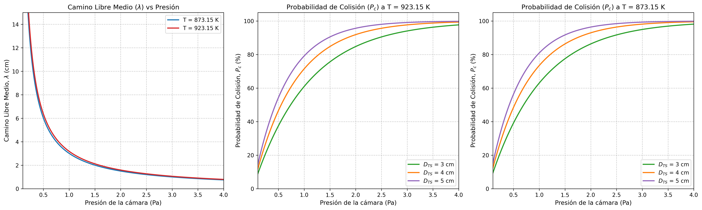

# Modelado de SAW Rayleigh y cinética de plasma de pulverización catódica

Repositorio de física computacional para modelar películas delgadas de nitruro de aluminio (AlN) y nitruro de aluminio dopado con escandio (ScₓAl₁₋ₓN) sobre sustratos de Si(111), con aplicación potencial en sensores MEMS de ondas acústicas superficiales (SAW).

## Alcance actual

El cuaderno implementado estudia la cinética de transporte de especies pulverizadas en un plasma reactivo Ar/N₂. El análisis compara el camino libre medio con la distancia blanco-sustrato y estima la probabilidad de colisión en fase gaseosa. El modelado de modos SAW y de propiedades de los materiales forma parte del objetivo general del repositorio, pero todavía no está incluido en los resultados disponibles.

## Contenido

### `notebooks/01_sputtering_plasma_kinetics.ipynb`

Cuaderno paso a paso que:

1. Define las condiciones de operación y las constantes del modelo.
2. Calcula el camino libre medio para distintos valores de presión y temperatura.
3. Estima la probabilidad de colisión para varias distancias blanco-sustrato.
4. Genera las figuras de los barridos en unidades de cámara (Torr) y del Sistema Internacional (Pa).

Los cálculos reutilizan las funciones de [`src/plasma_kinetics.py`](src/plasma_kinetics.py).

### Fundamento teórico

El camino libre medio se aproxima suponiendo partículas de gas con radio efectivo `r_mean` y una distribución homogénea:

$$
\lambda = \frac{k_B T}{\sqrt{2}\,4\pi r_{\text{mean}}^2 P}
$$

donde `k_B` es la constante de Boltzmann, `T` la temperatura absoluta y `P` la presión. La probabilidad de que una especie experimente al menos una colisión al recorrer la distancia blanco-sustrato `D_TS` se modela como:

$$
P_c = 1 - \exp\left(-\frac{D_{TS}}{\lambda}\right)
$$

Un camino libre medio mayor que `D_TS` corresponde a menor probabilidad de colisión y transporte más balístico. Al aumentar la presión, `λ` disminuye y `P_c` aumenta, lo que representa un transporte más colisionado o difusivo.

### Parámetros explorados

- Radio efectivo: `r_mean = 1.5 × 10⁻¹⁰ m`.
- Barrido en unidades de cámara: presión de `1–30 mTorr`, temperaturas de `500–650 °C` y distancias blanco-sustrato de `6, 8, 10 y 12 cm`.
- Barrido SI: presión de `0.1–4.0 Pa`, temperaturas de `873.15 K` y `923.15 K` (600 y 650 °C) y distancias de `3, 4 y 5 cm`.

### Resultados obtenidos

- En el barrido de `1–30 mTorr`, el camino libre medio va aproximadamente de `20–24 cm` a `0.67–0.80 cm` para las temperaturas estudiadas.
- A `650 °C`, para distancias de `6–12 cm`, la probabilidad de colisión pasa de aproximadamente `22–39 %` a `1 mTorr` a más de `99.9 %` a `30 mTorr`.
- En el barrido SI, a `650 °C`, `λ` disminuye de aproximadamente `31.9 cm` a `0.1 Pa` a `0.80 cm` a `4 Pa`. Para distancias de `3–5 cm`, `P_c` aumenta de aproximadamente `9–15.3 %` a `97.7–99.9 %`.

Estos resultados son las estimaciones del modelo de camino libre medio y no una validación experimental del proceso de deposición.

### Figuras

Las imágenes se generan en resolución de 300 DPI al ejecutar el cuaderno.

**Barrido en unidades de cámara:**


**Barrido en unidades SI:**



## Estructura del repositorio

```text
saw-aln-si-multiphysics/
├── data/          # Parámetros de materiales y resultados de simulación
├── images/        # Figuras generadas por los cuadernos
├── notebooks/     # Cuadernos de simulación paso a paso
├── src/           # Módulos Python reutilizables
├── LICENSE
├── README.md
└── requirements.txt
```

## Instalación y ejecución

Desde la raíz del repositorio, instala las dependencias y abre Jupyter:

```bash
python -m pip install -r requirements.txt
jupyter notebook
```

Ejecuta `notebooks/01_sputtering_plasma_kinetics.ipynb` desde Jupyter. El cuaderno guarda las figuras en `images/`.
