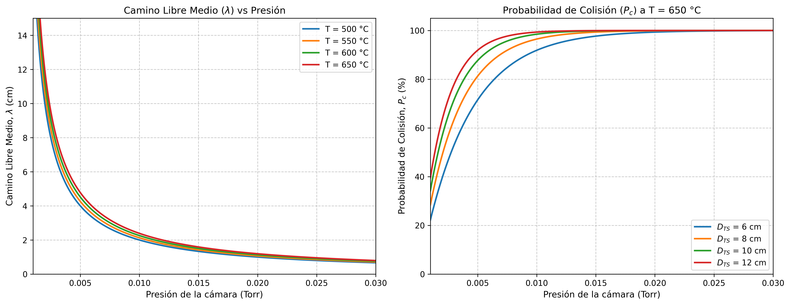
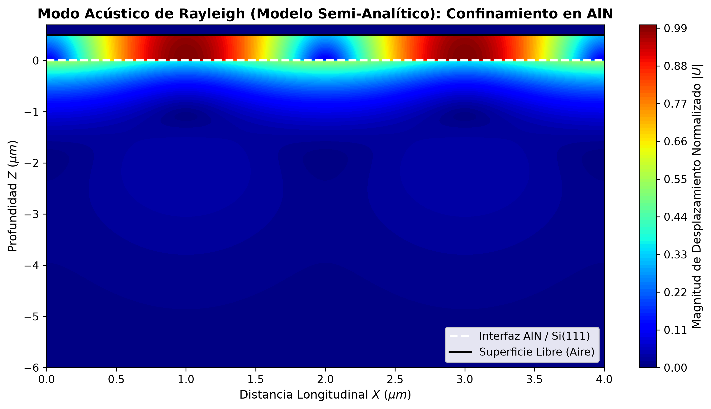
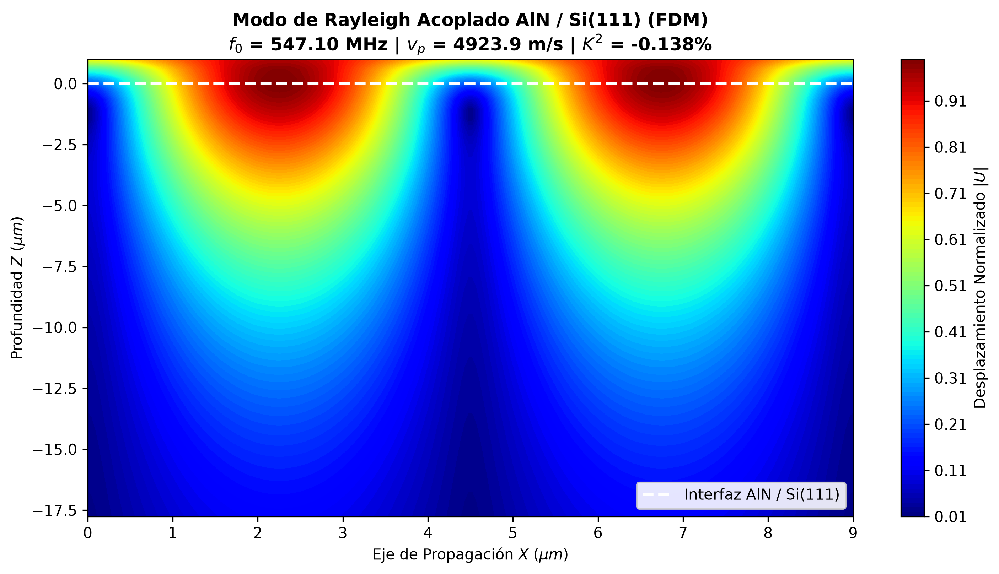
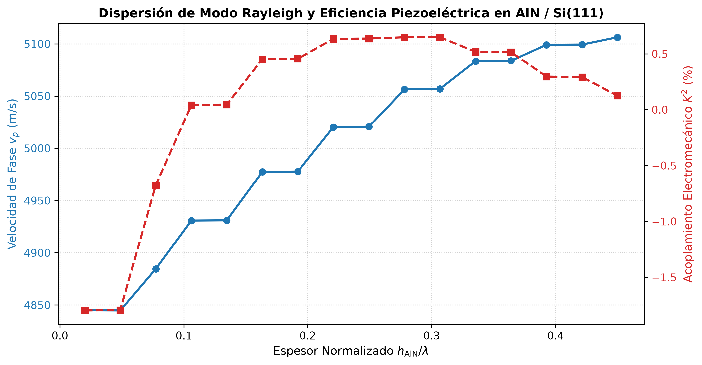

# Modelado multifísica de SAW en AlN/Si(111) y cinética de plasma

Repositorio de física computacional para estudiar heteroestructuras piezoeléctricas de nitruro de aluminio (AlN) sobre silicio cristalográfico Si(111). Incluye un modelo de transporte de especies pulverizadas y simulaciones de ondas acústicas superficiales (SAW) tipo Rayleigh, con aplicación potencial en sensores MEMS.

## Contenido

| Cuaderno | Contenido principal |
| --- | --- |
| [`01_sputtering_plasma_kinetics.ipynb`](notebooks/01_sputtering_plasma_kinetics.ipynb) | Camino libre medio y probabilidad de colisión en una descarga reactiva Ar/N₂ |
| [`02_simulacion_saw_aln_si111.ipynb`](notebooks/02_simulacion_saw_aln_si111.ipynb) | Tensores constitutivos, transformación de Bond, modo de Rayleigh y dispersión SAW |

Los cálculos compartidos están implementados en [`src/plasma_kinetics.py`](src/plasma_kinetics.py) y [`src/rayleigh_confinement.py`](src/rayleigh_confinement.py).

## 1. Cinética del plasma de pulverización

El primer cuaderno modela el transporte balístico frente al régimen difusivo de especies pulverizadas en atmósfera reactiva Ar/N₂ durante el crecimiento de películas delgadas de AlN.

El camino libre medio se aproxima mediante

$$
\lambda=\frac{k_B T}{\sqrt{2}\,4\pi r_{\text{mean}}^2P}
$$

donde $k_B$ es la constante de Boltzmann, $T$ la temperatura absoluta, $P$ la presión y $r_{\text{mean}}=1.5\times10^{-10}$ m el radio efectivo utilizado en el modelo.

La probabilidad de al menos una colisión durante el recorrido blanco-sustrato $D_{TS}$ es

$$
P_c=1-\exp\left(-\frac{D_{TS}}{\lambda}\right).
$$

### Barridos explorados

- Presión en cámara: 1–30 mTorr, temperaturas de 500–650 °C y distancias blanco-sustrato de 6, 8, 10 y 12 cm.
- Presión SI: 0.1–4.0 Pa, temperaturas de 600 y 650 °C y distancias de 3, 4 y 5 cm.

### Resultados representativos

- Entre 1 y 30 mTorr, $\lambda$ disminuye aproximadamente de 20–24 cm a 0.67–0.80 cm.
- A 650 °C, $P_c$ pasa de aproximadamente 22–39 % a 1 mTorr a más de 99.9 % a 30 mTorr.
- En el barrido SI, $\lambda$ disminuye de aproximadamente 31.9 cm a 0.1 Pa a 0.80 cm a 4 Pa.
- Para distancias de 3–5 cm, $P_c$ aumenta aproximadamente de 9–15.3 % a 97.7–99.9 %.

Estos valores son estimaciones del modelo de camino libre medio y no sustituyen una caracterización experimental del proceso de deposición.

### Figuras de cinética



*Barrido de presión en unidades de cámara.*


*Barrido de presión en unidades del Sistema Internacional.*

## 2. Modelado SAW Rayleigh en AlN/Si(111)

El segundo cuaderno trabaja con:

1. Tensores elásticos de AlN con simetría hexagonal 6 mm y eje $c$ orientado en $Z$.
2. Matriz piezoeléctrica y permitividad del AlN.
3. Tensor elástico cúbico del silicio y transformación de Bond hacia la superficie cristalográfica Si(111).
4. Aproximación semi-analítica del desplazamiento superficial.
5. Solucionador 1D SAFE / diferencias finitas acoplado con endurecimiento piezoeléctrico.

Para la configuración representativa del cuaderno:

- Longitud de onda de diseño: $\lambda_{\mathrm{SAW}}=4.0$ µm.
- Espesor de AlN: $h_{\mathrm{AlN}}=0.5$ µm.
- Espesor normalizado: $h_{\mathrm{AlN}}/\lambda_{\mathrm{SAW}}=0.111$.
- Silicio Si(111) rotado: $C_{11}=194.40$ GPa, $C_{33}=203.97$ GPa y $C_{44}=60.47$ GPa.
- Frecuencia de resonancia FDM: 547.10 MHz.
- Velocidad de fase libre: 4923.92 m/s.
- Velocidad metalizada: 4927.31 m/s.
- Acoplamiento electromecánico guardado en el cuaderno: $K^2=-0.138$ %.

El barrido de espesor normalizado cubre $h_{\mathrm{AlN}}/\lambda_{\mathrm{SAW}}$ entre 0.02 y 0.45, mostrando simultáneamente la velocidad de fase y el acoplamiento electromecánico.

### Figuras SAW



*Aproximación semi-analítica del confinamiento y perfil de desplazamiento.*



*Modo 1D de Rayleigh para la heteroestructura AlN/Si(111).*



*Velocidad de fase y $K^2$ frente al espesor normalizado.*

> Nota: el signo negativo de $K^2$ en la salida representativa se conserva tal como lo calculó el cuaderno (`v_open - v_short`). Debe interpretarse como parte de la aproximación FDM actual y no como una propiedad concluida del material hasta validar completamente las condiciones eléctricas y el esquema numérico.

## Estructura del repositorio

```text
saw-aln-si-multiphysics/
├── data/          # Datos auxiliares y resultados
├── images/        # Figuras generadas por los cuadernos
├── notebooks/     # Cuadernos de cinética y SAW
├── src/           # Funciones Python reutilizables
├── LICENSE
├── README.md
└── requirements.txt
```

## Instalación y ejecución

Desde la raíz del repositorio:

```bash
python -m pip install -r requirements.txt
jupyter notebook
```

Abre cualquiera de los cuadernos en `notebooks/`. Las figuras se generan y se guardan automáticamente en `images/`.
